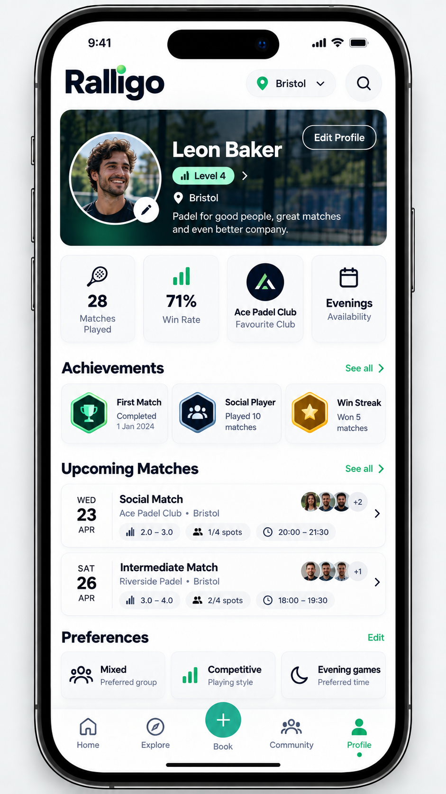

# Design reference

Visual direction for the app, taken from a mock of the Ralligo profile screen: `design/profile-mock.png`. There is no Figma or source file, so the values below are **estimated by eye from the image**. Treat them as a starting point and adjust once the screens are built.

## What we are adopting (visual language)

| Element | Direction |
| --- | --- |
| Accent colour | Emerald green, about `#12A150`. Used for active tab, links such as "See all" and "Edit", level badge, primary buttons |
| Accent tint | Pale green, about `#CFF5DC`, for badge backgrounds |
| Hero / dark surface | Very dark green, about `#0B2E22`, with an image behind (profile header) |
| Background | White `#FFFFFF`; card surface `#F7F8F7` with a hairline border `#E8EBE9` and a soft shadow |
| Text | Near-black `#0F1A14` for headings; grey `#6B7570` for secondary text |
| Corner radius | Cards about 20 px; chips and badges fully rounded (pill); avatars circular |
| Type | Bold, tight sans-serif headings; small grey secondary text; section titles with a green link on the right |
| Chips | Pill chips with a small icon plus text (level range, spots left, time) |
| Match card | Date block on the left (weekday, day, month), title and venue, chip row, small avatar stack and chevron on the right |
| Tab bar | White bar, green active icon and label |

Assumptions: light theme only for v1 (the mock has no dark variant); the system font is used unless a brand font is chosen later.

## What the mock shows that is not in the current plan

These are roadmap items, not part of `add-accounts-profiles-listings`:

- Numeric level ("Level 4") and level ranges ("2.0 - 3.0"); v1 uses self-rated tiers.
- Matches played, win rate and achievements; these need recorded results.
- Profile photo and edit-photo button.
- Favourite club, availability, and playing preferences (group mix, playing style, preferred time).
- Home / Explore / Book / Community tabs, a raised centre action button, and a city selector in the header.

The match card in the mock is the best template for the listing card in Discover.

## Open points

- Final hex values and fonts, once someone fixes them in a design file.
- Whether to keep a raised centre button for "Create". The native tab bar in use does not support one, so v1 uses a normal tab.
