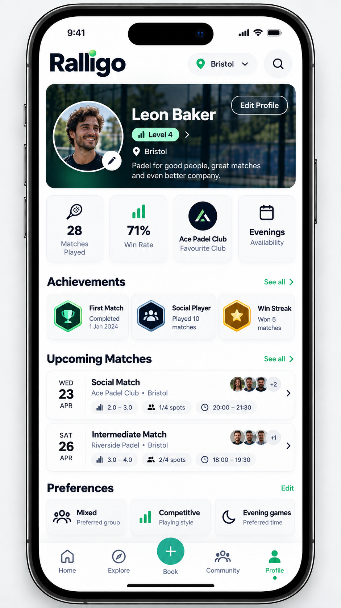

# Design reference

The app follows the **Padel Pink** design system: white screens, one hot pink, big round shapes, Outfit. It is a Claude design-system artifact (<https://claude.ai/artifact/WD22rDN9bJZfQvDqs1Eh14>) that was generated without access to this codebase, so the code is the source of truth where the two differ. The earlier `design/profile-mock.png` (an estimate by eye, green) is superseded for colour and type; it still shows the screen layouts below.

## Tokens

`packages/ui/design/tokens.json` is a copy of the artifact's `tokens.json`. `packages/ui/src/theme/tokens.ts` is generated from it (`node packages/ui/scripts/generate-tokens.mjs`) and is not edited by hand. Re-run the script after replacing the JSON with a newer export.

| Group | In code | Notes |
| --- | --- | --- |
| Colour | `colors.pink500`, `colors.ink`, `colors.muted`, … | `pink500` is the brand and action colour and only safe with white text on it. Small pink text and icons on white or `pink100` use `pink700` |
| Type | `type.displayXl`, `type.label`, … | Outfit, one font family per weight (`Outfit_400Regular` to `Outfit_800ExtraBold`). Never set `fontWeight`: Android ignores it for custom fonts. Em letter spacing is converted to pixels |
| Spacing | `spacing.space1` … `space8` | 4, 8, 12, 16, 20, 24, 32. Screen margin `space5`, card padding `space4` |
| Radius | `radius.xs` … `radius.pill` | Cards `lg`, sheets and the feature card `xl`, buttons, pills and badges `pill` |
| Borders | `borderWidth` | 1.5, a real width, not `StyleSheet.hairlineWidth` |
| Shadows | `shadows.shadowBrand`, `shadowFloat`, `shadowCard` | iOS shadow props plus an Android `elevation`. Android elevation is grey and will not match the pink glow of `shadowBrand`; check on a device |

## Components

Shared components live in `@padel/ui`, grouped as the design system groups them. A level is built only from the levels below it and never restyles them.

| Level | Components |
| --- | --- |
| Atoms | `Button` (primary, secondary, choice pill), `IconButton`, `Badge`, `Icon`, `Avatar`, `Input`, `Checkbox`, `Radio`, `Switch`, `HelperText`, `Logo`, `ThemedText`, `ThemedView` |
| Molecules | `FormField`, `SearchField`, `Card`, `FeatureCard`, `Banner`, `SegmentedControl`, `DateField` |
| Organisms | `AppBar`, `BottomSheet` |

Anything tied to a domain concept lives in that domain's package, built from the shared pieces: `PlayerRow` in `@padel/players`, `ProfileHeader` and the profile form in `@padel/profiles`, `SlotPicker` and `BookingBar` in `@padel/bookings`. A pattern used on only one screen stays on that screen until a second one needs it.

Forms follow the design system: the label sits above the field and is always visible, optional fields say "Optional" on the right (no asterisks), helper text is below and an error replaces it, with an alert icon. Choose one of a few with `Radio`, many with `Checkbox`, an instant setting with `Switch`; choice pills are for filtering lists.

## Where the app differs from the design system

- **Tab bar:** the app keeps native tabs (`NativeTabs`) and restyles them with the pink tint, Outfit labels and, where the platform has one, a filled icon for the active tab. The floating pill bar in the design cannot be drawn with native tabs and is deferred.
- **Icons:** the 26-icon set plus `alert`, which the design asks for beside errors but does not include. Icons are SVG, so they cannot be used inside the native tab bar.
- **Avatars** are chosen by the consumer (`ink`, `tint`, `brand`); the old per-name colour tiles are gone.
- **Spacing:** the design's README mentions 14 px card and row padding, which is not a token; the code uses `space4` (16).

## What the mock shows that is not in the current plan

These are roadmap items, not part of `add-accounts-profiles-listings`:

- Numeric level ("Level 4") and level ranges ("2.0 - 3.0"); v1 uses self-rated tiers.
- Matches played, win rate and achievements; these need recorded results.
- Profile photo and edit-photo button.
- Favourite club, availability, and playing preferences (group mix, playing style, preferred time).
- Home / Explore / Book / Community tabs, a raised centre action button, and a city selector in the header.

The match card in the mock is the best template for the listing card in Discover.

## Open points

- Whether to keep a raised centre button for "Create". The native tab bar does not support one, so v1 uses a normal tab.
- A custom floating tab bar, once we are ready to give up native tabs.
