# Padel App design story

Text and image snapshot of the design walkthrough deck, taken 2026-11-19 (19 slides). The deck is the live version and may have been edited since.

Deck: https://claude.ai/artifact/EtFckw6x59nD6U9oEHTTDG (private, needs access). Built with the Padel Pink design system, see [padel-pink-design-system.md](padel-pink-design-system.md).

Screens are renders of the design canvas (https://claude.ai/artifact/SfUSwPjN1KHwUYk7c7RUgp) at 390 x 844, in [images/design/](images/design/). Re-render them if the canvas changes.

## 1. Cover

Designing Padel App: from first sketch to hot pink, and why it works.

## 2. Where we started: a safe first pass

The first in-app look: bright green accent (taken from one mock), Plus Jakarta Sans, 14 flat components styled one by one, light theme only.

| Swatch | Hex |
| --- | --- |
| Bright green | `#22DB6E` |
| Deep green | `#0E7A45` |
| Green tint | `#C9F7DD` |
| Dark hero | `#0B2E22` |

It worked as a starting point. It did not yet say anything about padel.

## 3. Why we changed it

- **A rough estimate:** the look came from a single mock, with no complete system behind it.
- **No shared structure:** flat, screen-specific components risked drifting on every new screen.
- **Not recognisable:** in our view a green accent says "sports app", not "padel". This is our judgement, not research.

Goal: a look that is simple, striking and clearly ours, on a system we can keep consistent.

## 4. First, four light directions

| Direction | Character | Type | Render |
| --- | --- | --- | --- |
| Sea Glass | Mint, teal and lime, floating dark tab bar | Plus Jakarta Sans | 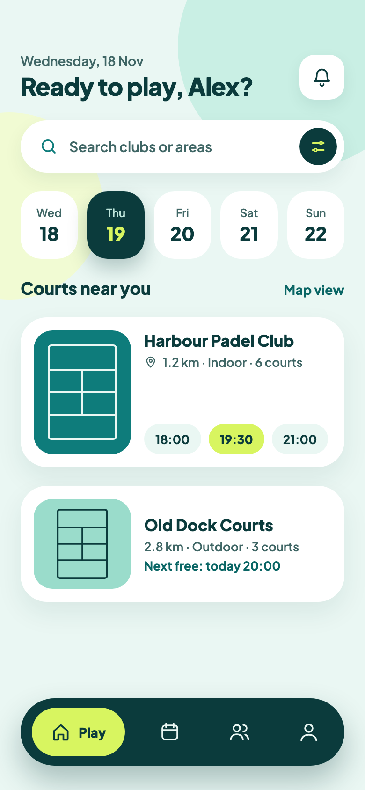 |
| Sky Serve | Blue, yellow, hard shadows | Space Grotesk | 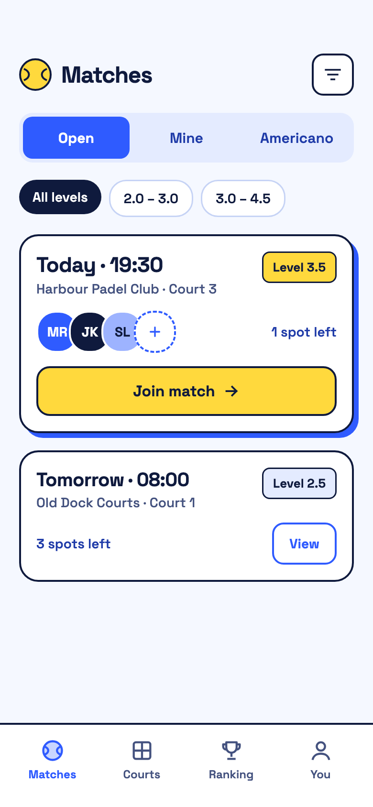 |
| Lilac Social | Lilac, coral, community feel | Bricolage Grotesque | 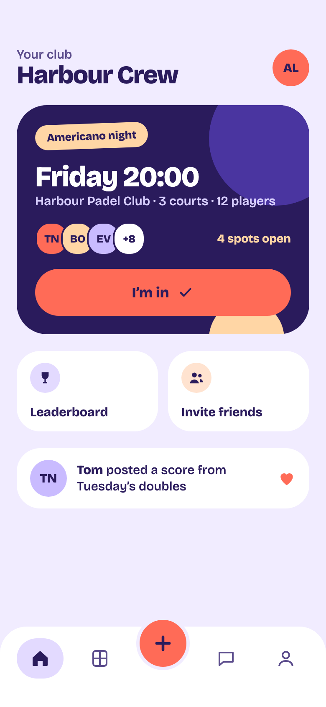 |
| Paper Court | Off-white, hairlines, lime, monospaced numbers | Instrument Sans and DM Mono | 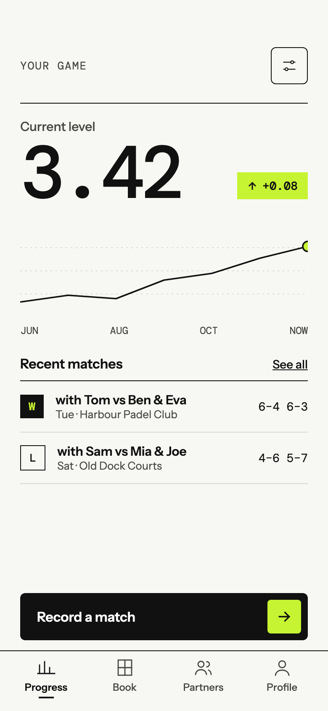 |

## 5. Pink is already at home in sport

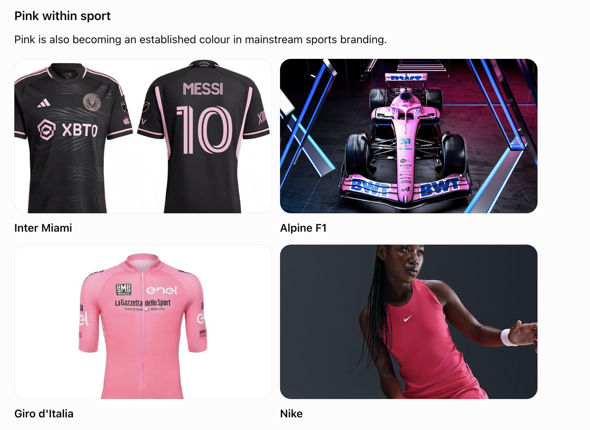

- Inter Miami, Alpine F1, Giro d'Italia and Nike all use pink.
- It reads as bold and confident, not only soft.
- The app is about meeting people, not just performance, so a warm, social colour fits.

Pink could be a real point of difference for a padel app. Images belong to their owners, internal reference only. More in [pink-reference.md](pink-reference.md).

## 6. Four pink directions, used with restraint

| Direction | Feel | Colours |
| --- | --- | --- |
| Electric pink | Energetic, confident, disruptive | `#FF007F`, `#17171C`, `#FFFFFF`, `#FFF0F6` |
| Premium magenta | Sophisticated, modern, competitive | `#C21869`, `#20182B`, `#FFFFFF`, `#F8EFF5` |
| Soft pink | Approachable, friendly, community-led | `#F5A9C4`, `#222222`, `#FFFFFF`, `#FDF3F6` |
| Pink and lime | Youthful, expressive, sporty | `#FF3987`, `#D5FA45`, `#151515`, `#FFFFFF` |

The 70 / 20 / 10 rule: 70% white (backgrounds and cards), 20% ink (text, icons), 10% pink (the main action, selected states, branding).

These are proposed directions, not brand guidelines. Our pink, `#E6005C`, sits close to Electric pink. Test with players before committing.

## 7. Then we refined one: hot pink on white

| Courts map | Games | Book a court | Profile |
| --- | --- | --- | --- |
| 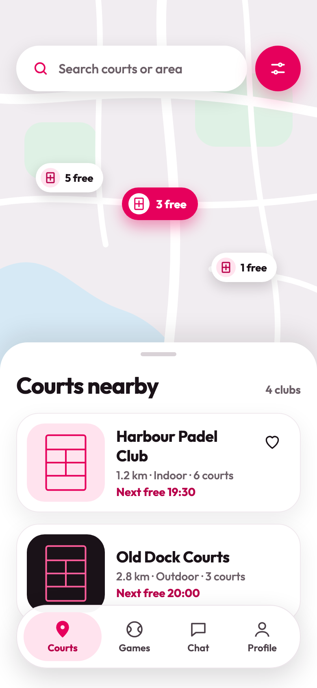 | 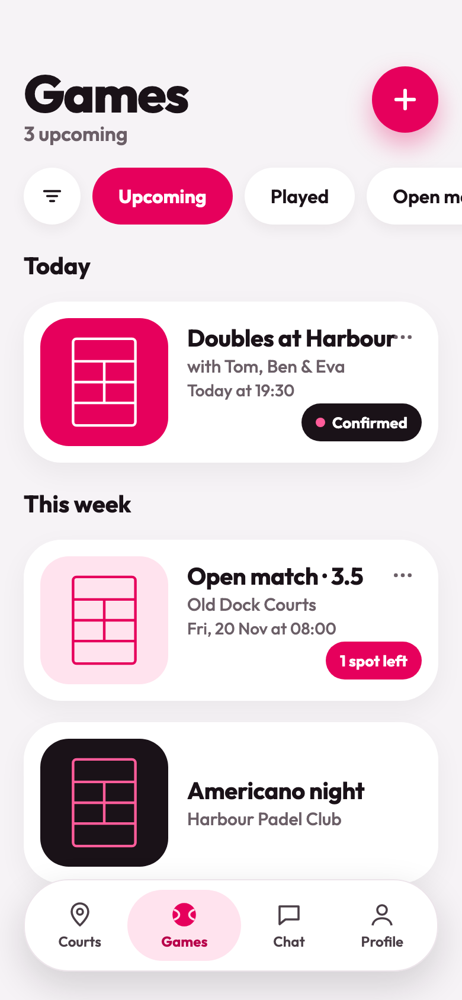 | 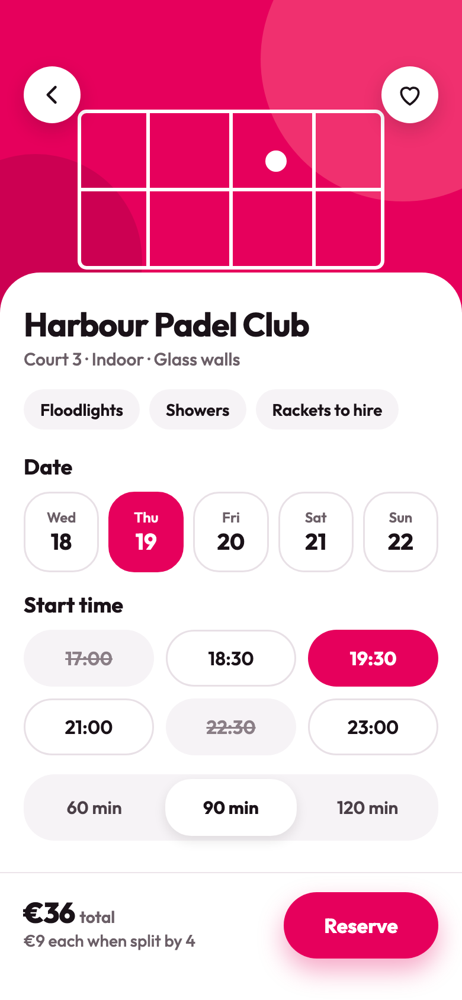 | 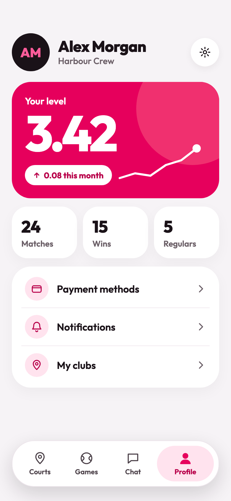 |

## 8. From green to hot pink

| | Before | After |
| --- | --- | --- |
| Palette | `#22DB6E`, `#0E7A45`, `#C9F7DD`, `#0B2E22` | `#E6005C`, `#FFE3EE`, `#1A1218`, `#FFFFFF` |
| Typeface | Plus Jakarta Sans | Outfit |
| Feel | Safe, familiar, interchangeable | Bold, friendly, recognisable |

## 9. The new look, in one screen

Match details as built: a pink hero with a padel court, a white sheet for the details, one hot action (Request to join), initials instead of stock photos.

## 10. The match request flow

| Match details | Pending | Accepted | Manage match |
| --- | --- | --- | --- |
| 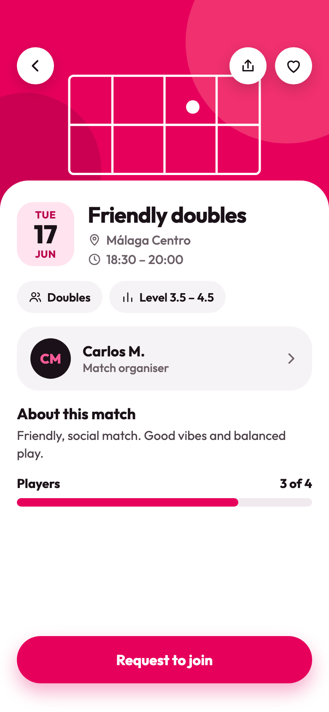 | 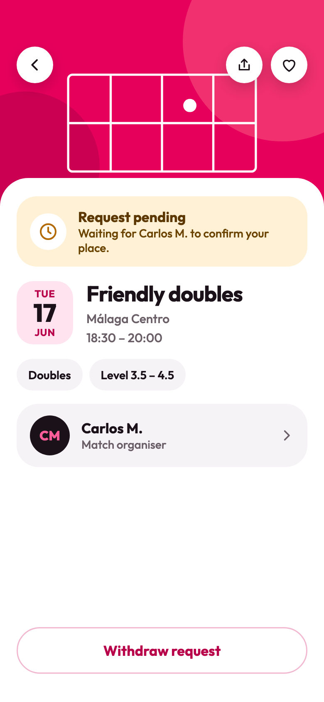 | 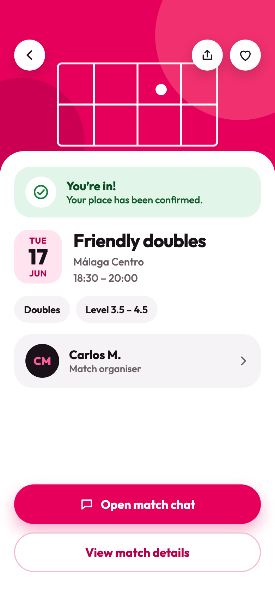 | 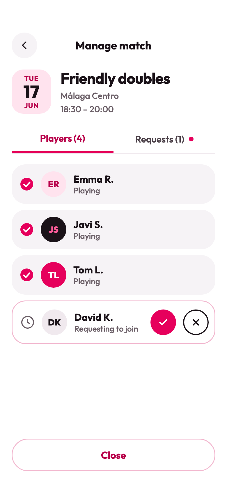 |

## 11. Why it works: simple

One hot pink, everything else quiet. White-first screens, pink only for the main button, selected states and the hero, round shapes throughout, hairline borders instead of shadows, no emoji, no stock photos.

## 12. Why it works: unique

The court itself is the picture, in three colourways: pink on pale pink, white on pink, light pink on ink. Players are initials in a circle. Pink where many sports apps use green or blue (a general impression, worth checking against competitors).

## 13. Why it works: striking

Pink surfaces for heroes and key cards, large type on the colour, one glow on the primary button. White text on pink passes 4.5:1 contrast.

## 14. Why it works: clear

Every status says what it means, with an icon and a message, never colour alone.

- **Pending:** amber, "Request sent. Waiting for Carlos M."
- **Accepted:** green, "You're in!"
- **Declined:** ink, not red, so it never looks like a brand action.

Text meets 4.5:1 contrast. Touch targets are at least 44px.

## 15. Why it works: type

Outfit only, in three voices: heavy and tight for titles and numbers (800), bold for names and headings (700), regular for reading (400). Weight sets hierarchy, not extra sizes. Sentence case, short words.

## 16. Why it works: spacing

| Gap | Use |
| --- | --- |
| 20 | Screen margin |
| 16 | Inside cards |
| 12 | Between cards |
| 8 | Between pills |
| 44 | Smallest touch target |

Fewer spacing values make screens feel related.

## 17. Why it works: light, not dark

- The pink is the star: on white, one hot colour is easy to spot and read.
- Clean and social: white feels open, which suits a community sport.
- Proven contrast: text and pink pairings pass 4.5:1.
- One theme is simpler to build, test and keep consistent at this stage.

Dark mode is out of scope for now. The tokens have a theme slot, so a dark theme can be added later. To test: how readable the light screens are outdoors in bright sun.

## 18. Built as a system

- **Atoms:** Button, Badge, Icon, Avatar, Input, Checkbox, Radio, Switch.
- **Molecules:** FormField, SearchField, Card, status banners.
- **Organisms:** AppBar, BottomSheet, tab bar.
- **Shared:** generic pieces live in one shared package.
- **With their domain:** pieces that know about players, profiles or bookings live with that feature.
- One tokens file feeds the app and the design system.

## 19. What we would like your view on

- Does hot pink feel like the brand we want?
- Name and logo: how should they sit on the pink?
- Court motif or real photography on match cards?
- When does dark mode become a priority?

Still to do: check the design on Android, a custom floating tab bar, and test the light screens outdoors with real players.
