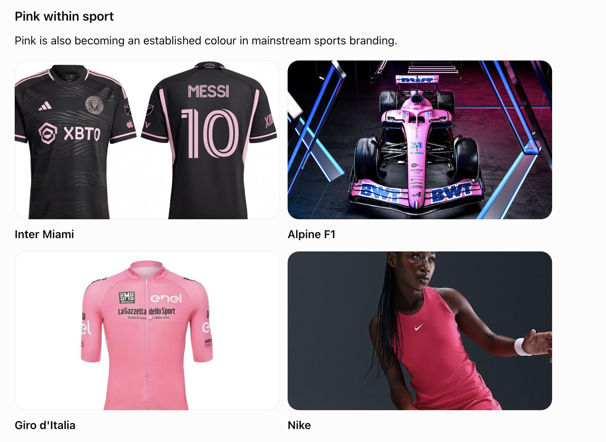

# Why pink: reference

Background material on using pink for a padel app, kept as a reference for the design story. It is research and opinion, not brand guidelines. Captured 2026-11-19.

## Pink within sport

Pink is becoming an established colour in mainstream sports branding.

Examples shown: Inter Miami, Alpine F1, Giro d'Italia, Nike. The images belong to their owners. Use them internally as reference only, and do not publish them outside the team.

## Would pink work for a padel app?

The view captured here: it could be a strong commercial differentiator, particularly because the app is about social interaction, finding players and organising matches, rather than purely sporting performance.

Suggested approach: explore four directions, then test them with both male and female padel players before committing, particularly for brand perception and accessibility.

| Direction | Feel | Colours |
| --- | --- | --- |
| Electric pink | Energetic, confident, disruptive | `#FF007F`, `#17171C`, `#FFFFFF`, `#FFF0F6` |
| Premium magenta | Sophisticated, modern, competitive | `#C21869`, `#20182B`, `#FFFFFF`, `#F8EFF5` |
| Soft pink | Approachable, friendly, community-led | `#F5A9C4`, `#222222`, `#FFFFFF`, `#FDF3F6` |
| Sporty pink and lime | Youthful, expressive, unmistakably sporty | `#FF3987`, `#D5FA45`, `#151515`, `#FFFFFF` |

These palettes are proposed design directions, not existing brand guidelines.

## How to use it in the app

Rather than making the whole interface pink, follow a restrained approach, as Klarna and Lyft do:

| Share | Use |
| --- | --- |
| 70% | White or off-white: screen backgrounds and cards |
| 20% | Charcoal: typography, icons and navigation |
| 10% | Pink: primary buttons, selected tabs, branding and interactive elements |

The recommendation: lean towards electric pink with charcoal and white. Bold typography, sports photography, clean layouts and restrained use of colour could make it feel athletic, premium and gender-neutral.

## How this relates to what we built

- Our brand pink is `#E6005C` (Padel Pink design system). It sits close to electric pink but deeper, and white text on it passes 4.5:1 contrast.
- We follow the same restraint: white first, ink for text, pink for the main action, selected states and the hero. See [padel-pink-design-system.md](padel-pink-design-system.md).
- This reference suggests sports photography. Our design uses a padel court motif instead of photos for now. That is an open question on the design story's last slide.
- We have not tested the palette with players. Perception, gender-neutrality and accessibility are still to validate.

See also [padel-app-design-story.md](padel-app-design-story.md).
